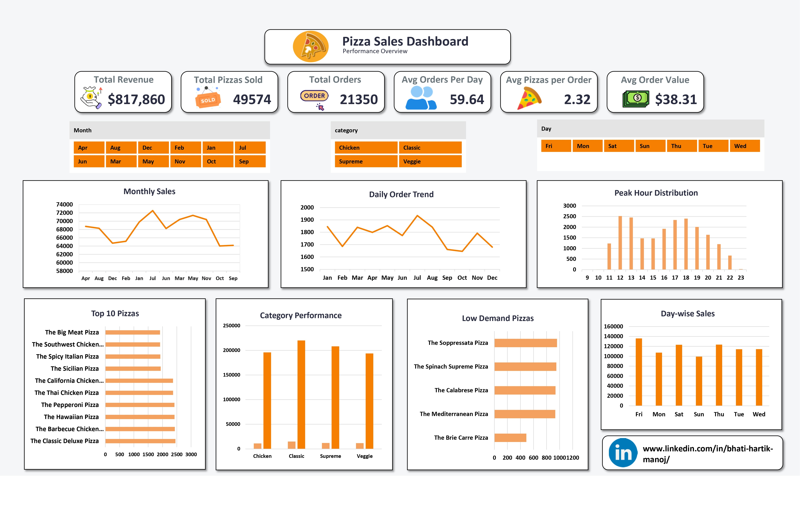
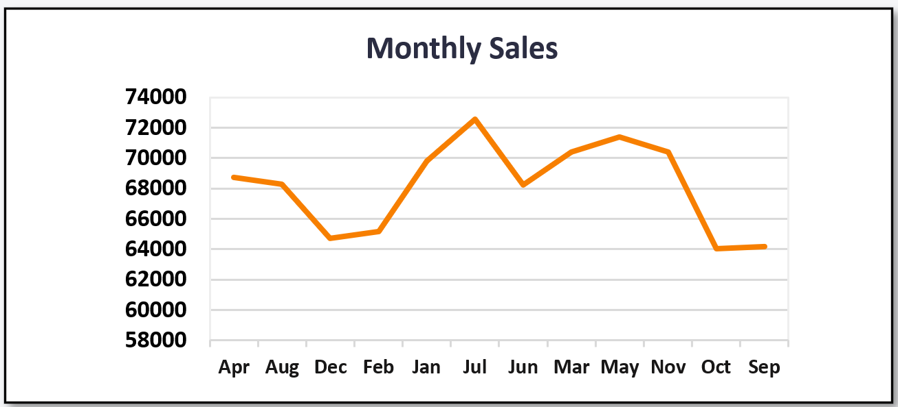
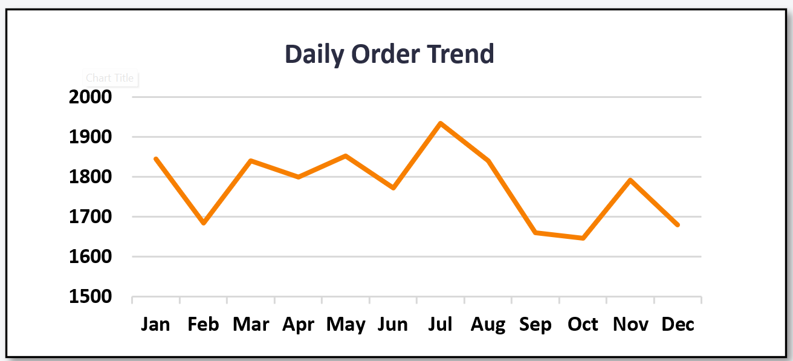
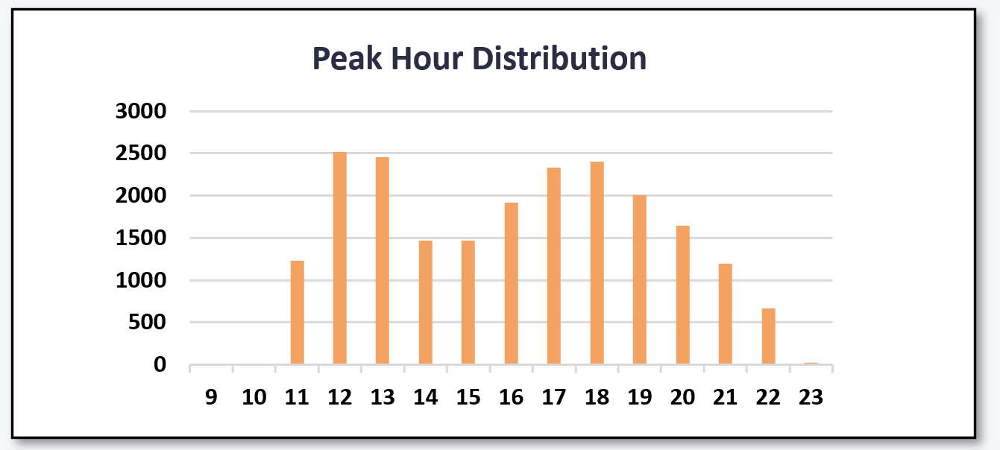
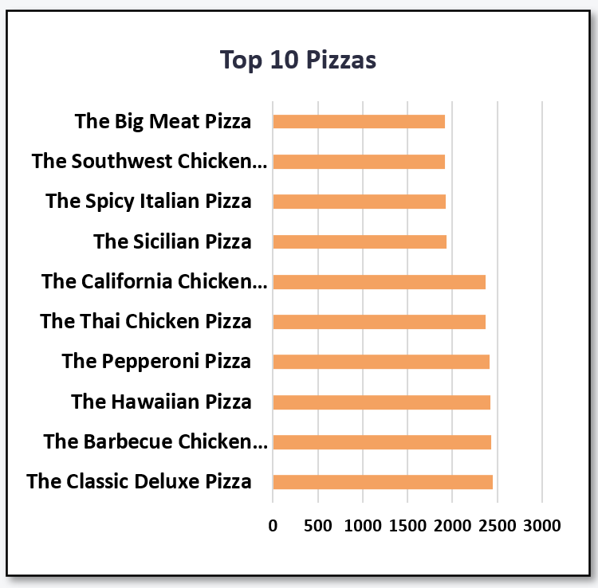
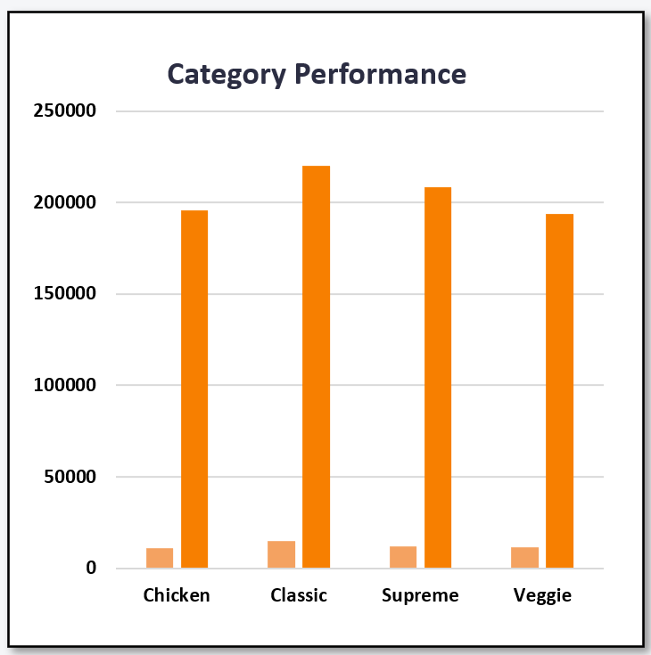
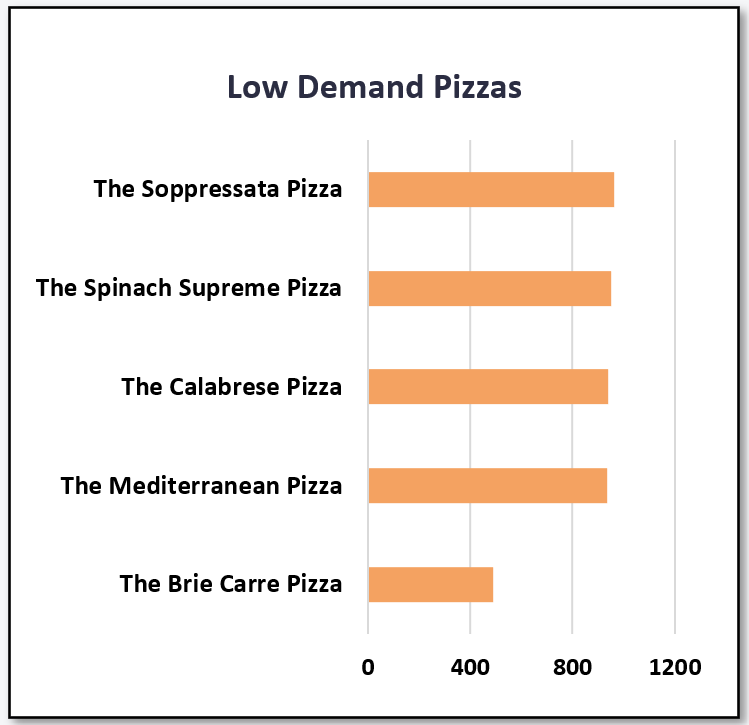
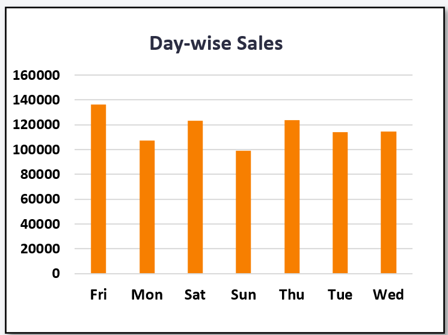

# 🍕 Pizza Sales Analysis & Interactive Dashboard | Microsoft Excel

## 📌 Project Overview

This project focuses on analysing pizza sales data using Microsoft Excel to identify sales trends, customer ordering patterns, product performance, and revenue distribution.

An interactive Excel dashboard was developed to transform raw sales transactions into meaningful business insights. The dashboard provides an overview of key performance indicators (KPIs) and allows users to explore sales performance across different months, pizza categories, days, and ordering hours.

The objective of this project is to demonstrate practical data analytics skills, including data organisation, data analysis, PivotTables, data visualisation, and dashboard development.

## 🎯 Project Objectives

- Analyse overall pizza sales performance and revenue generation.
- Identify monthly sales trends and fluctuations.
- Understand daily order patterns and peak ordering hours.
- Identify the best-selling and lowest-selling pizza products.
- Compare sales performance across different pizza categories.
- Evaluate daily revenue performance.
- Present key findings through an interactive Excel dashboard.

## 🛠️ Tools & Technologies

| Tool | Purpose |
|---|---|
| Microsoft Excel | Data analysis and dashboard development |
| Excel Tables | Organising structured sales data |
| PivotTables | Summarising and analysing sales information |
| PivotCharts / Charts | Visualising sales trends and performance |
| Excel Slicers | Interactive data filtering |
| Data Visualisation | Presenting business insights |

## 📂 Dataset Information

The project uses pizza sales transaction data covering the period from January 1, 2015, to December 31, 2015.

The Excel workbook contains the following worksheets:

| Worksheet | Description |
|---|---|
| `pizzas` | Contains pizza IDs, pizza types, sizes, and prices. |
| `pizza_types` | Contains pizza names, categories, and ingredient information. |
| `orders` | Contains order IDs, order dates, and order times. |
| `order_details` | Contains order detail IDs, order IDs, pizza IDs, and quantities. |
| `PIVOT` | Contains PivotTable-based sales analysis and summaries. |
| `Dashboard` | Contains the final dashboard and visualisations. |

**Dataset size:**
- Total orders: 21,350
- Order detail records: 48,620
- Total pizzas sold: 49,574
- Analysis period: 1 year (2015)

## 📊 Key Performance Indicators (KPIs)

The dashboard presents the following key metrics:

| KPI | Value |
|---|---:|
| Total Revenue | $817,860.05 |
| Total Pizzas Sold | 49,574 |
| Total Orders | 21,350 |
| Average Orders Per Day | 59.64 |
| Average Pizzas Per Order | 2.32 |
| Average Order Value | $38.31 |

## 📈 Dashboard Preview



The dashboard provides a consolidated view of pizza sales performance through KPI cards, interactive filters, and multiple charts.

### Dashboard Components

**1. Monthly Sales Analysis**

Analyses monthly revenue performance to identify high-performing and low-performing months.



**2. Daily Order Trend**

Displays the number of orders across different months to understand changes in order volume.



**3. Peak Hour Distribution**

Identifies the hours with the highest order activity and helps understand customer ordering patterns.



**4. Top 10 Best-Selling Pizzas**

Highlights the top-performing pizza products based on sales quantity.



**5. Category Performance**

Compares pizza categories based on revenue and quantity sold.



**6. Low-Demand Pizzas**

Identifies pizza products with comparatively lower sales quantities.



**7. Day-wise Sales Analysis**

Compares revenue generated across different days of the week.



## 🔍 Key Business Insights

Based on the analysis performed in Excel, the following findings were identified:

**1. Overall Sales Performance**
- Total revenue reached $817,860.05.
- A total of 49,574 pizzas were sold across 21,350 orders.
- The average order value was $38.31.

**2. Monthly Sales Performance**
- July generated the highest monthly revenue of $72,557.90.
- October recorded the lowest monthly revenue of $64,027.60.
- Monthly revenue varied throughout the year.

**3. Category Performance**
- The Classic category generated the highest revenue of $220,053.10.
- Classic pizzas also recorded the highest category sales quantity, with 14,888 pizzas sold.
- Chicken, Supreme, and Veggie categories also contributed significantly to overall revenue.

**4. Product Performance**
- The Classic Deluxe Pizza was the highest-selling pizza, with 2,453 units sold.
- The Brie Carre Pizza had the lowest sales quantity among the products analysed, with 490 units sold.

**5. Day-wise Revenue Performance**
- Friday generated the highest revenue of $136,073.90.
- Sunday recorded the lowest revenue of $99,203.50.

**6. Customer Ordering Patterns**
- The dashboard indicates that order activity is concentrated around lunchtime and evening hours.
- Peak-hour analysis helps identify periods of higher ordering activity.

## 📋 Business Questions Answered

This project explores the following business questions:

1. What is the total revenue generated from pizza sales?
2. How many pizzas were sold during the analysis period?
3. What is the total number of orders?
4. What is the average order value?
5. Which month generated the highest revenue?
6. Which month recorded the lowest revenue?
7. Which pizza category contributes the most revenue?
8. Which pizzas are the best-selling products?
9. Which pizzas have comparatively lower demand?
10. During which hours are the most orders placed?
11. Which day of the week generates the highest revenue?
12. How do different pizza categories compare in terms of sales quantity and revenue?

## ⚙️ Project Workflow

The project followed a structured data analysis workflow:

1. **Data Understanding:** Reviewed the available sales tables and identified the relationships between orders, order details, pizza types, and prices.
2. **Data Organisation:** Worked with structured Excel tables to organise the sales information.
3. **Data Analysis:** Used PivotTables to summarise revenue, order counts, quantities, monthly trends, daily sales, and product performance.
4. **Data Visualisation:** Created charts to communicate sales patterns and comparisons.
5. **Dashboard Development:** Designed an interactive dashboard with KPI cards, charts, and filtering options.
6. **Business Insights:** Interpreted the analysis results to identify important sales trends and product performance.

## 📁 Project Files

```text
pizza-sales-analysis-excel/
│
├── Dashboard/
│   └── pizza-sales-dashboard.xlsx
│
├── Images/
│   ├── dashboard-overview.jpg
│   ├── monthly-sales-analysis.png
│   ├── daily-order-trend.png
│   ├── peak-hour-distribution.png
│   ├── top-10-pizzas.png
│   ├── category-performance.png
│   ├── low-demand-pizzas.png
│   └── day-wise-sales.png
│
├── Documentation/
│   └── data-dictionary.md
│
└── README.md
```

## 🚀 How to Explore This Project

1. Clone or download this repository.
2. Open the Excel workbook located in the `Dashboard` folder.
3. Navigate to the `Dashboard` worksheet.
4. Explore the KPIs and sales visualisations.
5. Use the available filters to analyse different segments of pizza sales.
6. Review the `PIVOT` worksheet to understand the underlying analysis.

**Note:** Open the workbook in Microsoft Excel for the intended interactive dashboard experience. Refresh PivotTables if necessary.

## 💡 Learning Outcomes

Through this project, I gained practical experience in:

- Working with structured sales datasets.
- Organising data across multiple related worksheets.
- Analysing sales performance using Excel PivotTables.
- Creating meaningful data visualisations.
- Designing KPI-based dashboards.
- Understanding product performance and sales trends.
- Translating analytical findings into business insights.

## 👨‍💻 Author

**Hartik Manoj Bhati**

B.Tech Computer Science & Engineering | Cyber Security

Interested in Data Analytics, Business Intelligence, and Data Visualisation.

**Skills:** Microsoft Excel | SQL | Power BI | Python

---

⭐ If you find this project useful, consider giving this repository a star!

*This project was developed as part of my hands-on learning and portfolio development in Data Analytics.*
